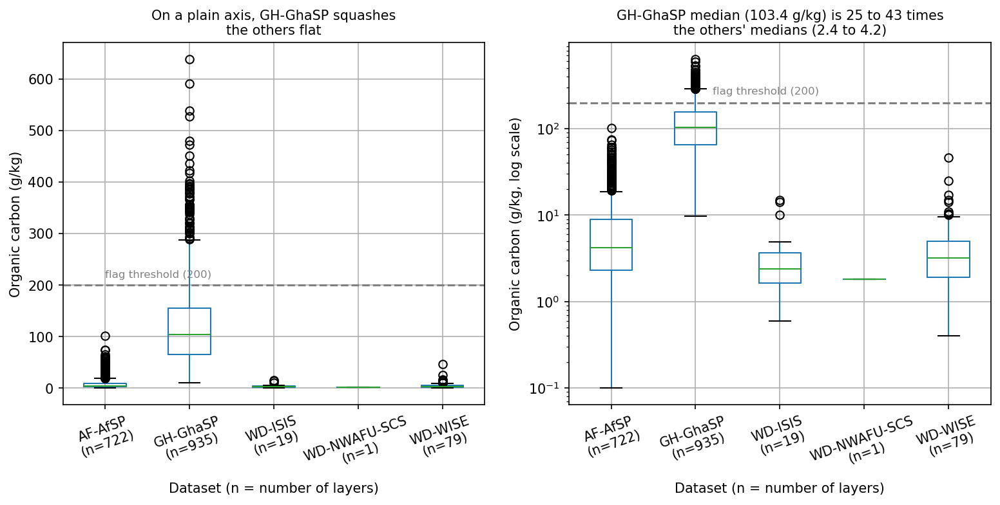

# GH-GhaSP reports organic carbon 25 to 43 times as high as other source datasets

*Independent learning project, Adam Mustapha Damba, November 2026.*

One dataset in the Ghana soil data reports organic carbon 25 to 43 times as high as the other source datasets, and the cause is not yet confirmed.

## The question
Is the organic carbon in the Ghana WoSIS layers consistent across its source datasets?

## The data
The data consists of 1,756 soil layers from 5 different source datasets across Ghana, sourced from the WoSIS December 2023 snapshot. Clay and sand are missing for about 72% of the layers.

## What I did
I joined the organic carbon, pH, clay and sand tables on layer_id, ran automated quality flags, and generated a cleaning report. The checks found 0 duplicates, 0 impossible values, and 144 unusually high carbon values (above 200 g/kg). All 144 came from GH-GhaSP, which is 15.4% of its 935 layers. I also verified the row count after every join to ensure all 1,756 rows were kept. To compare carbon levels, I used a boxplot on a log scale. I also wrote an alarm that compares each dataset's median with the typical dataset's; it flags only GH-GhaSP for carbon, and nothing for pH, clay or sand.

## What I found
GH-GhaSP has a median organic carbon of 103.4 g/kg, while the other datasets' medians (with at least 10 layers) are between 2.4 and 4.2. The pH data looked normal across all datasets (medians from 4.9 to 5.8). I left out the WD-NWAFU-SCS dataset from the comparison because it only has a single layer.

## What I ruled out
I tested two possible explanations. First, the recorded lab method is identical for the 144 flagged layers and the 791 normal layers within GH-GhaSP. Second, the flagged layers are not shallower (about 48 cm in both groups), and none are labelled as organic surface soil. Therefore, the metadata does not explain the anomaly, and the peat story is weakened.

## What I don't know yet
I don't yet know if GH-GhaSP recorded carbon in a different unit or scale, or if it has recording errors. Until this is resolved, pooled carbon averages for Ghana aren't reliable, and any clay or sand analysis uses only the 28% of layers that have values, none of them from GH-GhaSP.

## Next steps
I will check the GH-GhaSP documentation to confirm the units. If the unit differs, I will convert it and recheck. If it is real, I will analyze the dataset separately. If I cannot resolve it, I will ask the data provider.

## Reproduce it
To reproduce this, you need a local PostgreSQL copy of the WoSIS Ghana tables, a copy of `db_config.example.py` renamed to `db_config.py` with your credentials, and then run `python run_checks.py` from the `csa_soil_project` folder.

## Source and licence
Source: WoSIS (ISRIC). WoSIS data is licensed per row (CC BY and CC BY-NC variants), so attribution is required, and non-commercial limits apply to some rows. No raw data is stored in this repository.